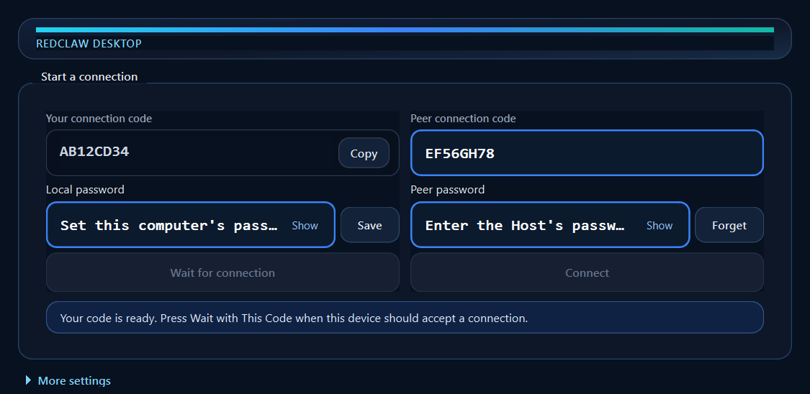

<div align="center">

# RedClawDesktop

**面向开发者的 Windows P2P 远程桌面与远端 Agent 工作台**

[English](README.en.md) · [下载 v0.1.12](https://github.com/70565912/RedClawDesktop/releases/tag/v0.1.12) · [构建文档](docs/README.md) · [问题反馈](https://github.com/70565912/RedClawDesktop/issues)

[](https://github.com/70565912/RedClawDesktop/releases/tag/v0.1.12)
[](https://github.com/70565912/RedClawDesktop/releases/tag/v0.1.12)
[](LICENSE)
[](CMakeLists.txt)
[](https://www.qt.io/)

</div>

RedClawDesktop 让开发者通过机器码连接自己的 Windows 开发机，在同一个界面中查看真实桌面、发送经过授权的键鼠输入，并与开发机上的 AI coding Agent 交互。连接采用在线 DHT rendezvous 与 ICE/STUN/TURN 协商，优先建立端到端 P2P 直连。

> `v0.1.12` 是 Windows x64 Developer Preview。修复能力 5 下控制端到主机的快捷键粘贴：Ctrl+V、Shift+Insert 和主机应用菜单粘贴不再因缺少进行中的传输而失败或无限等待，失败会显示在控制端。连接浮层不再滚动运行日志。既有画面、连接密码、按需剪贴板、远程声音及 Host 更新重启保护继续保留，按双方共同能力互通。详见 [发行说明](docs/releases/v0.1.12.md)。



## 为什么使用 RedClawDesktop

- **开发场景优先**：桌面画面、键鼠控制和 Agent 输出在一个工作台中协同。
- **机器码连接**：正常产品流程无需填写对端 IP 地址。
- **P2P 优先**：DHT 用于在线 rendezvous，ICE/STUN/TURN 用于连接协商和 NAT 穿透。
- **真实媒体链路**：Host 采集并编码桌面，Controller 解码并呈现；诊断预览不能替代真实链路验收。
- **明确授权边界**：远程输入、无人值守能力和 Agent 任务均受显式授权、租约和项目范围约束。

## 当前能力

| 能力 | v0.1.12 状态 |
| --- | --- |
| 连接密码 | 必填；无密码的 v0.1.3 及更早版本会被拒绝 |
| Windows Host / Controller 图形界面 | 可用 |
| Host 更新重启保护 | 管理员运行 GUI Host 后，连接期间自动启用；断开恢复原策略，强制重启存在系统限制 |
| 机器码与 public-DHT 在线 rendezvous | 可用 |
| ICE/STUN 直连、可配置 TURN | 可用，网络兼容性仍在扩展验证 |
| WGC / Desktop Duplication 真实桌面采集 | 可用 |
| H.264/HEVC 编解码与 D3D11 呈现 | 可用，具体后端取决于硬件与驱动 |
| 远程系统声音 | 可用；Controller 开启后 Host 采集共享模式系统声音。播放期间输出保持打开，关闭远程声音或结束会话才释放。两端都需具备音频能力 |
| 授权键盘和鼠标控制 | 可用；普通桌面鼠标移动受阻时提供恢复提示，安全桌面等场景会拒绝或暂停 |
| Control / Media / Agent 三通道 | 可用 |
| Codex / Cursor Provider 桥接 | 可用，需在 Host 上单独配置和授权 |
| 双向文件/文件夹传输 | 可用，含 SHA256 校验、冲突处理、取消与逐文件结果 |
| 按需剪贴板传送 | 双端能力 5 支持 Ctrl+V、Shift+Insert 和应用原生粘贴；文件先确认再传输，含进度与取消 |
| 内嵌 PowerShell 终端 | 可用，ConPTY + 随包 WebView2/xterm.js，同一桌面会话重连保留 Shell |
| 独立重启与完整目录升级 | 可用，当前用户权限、启动失败回滚，不依赖发起 Agent/终端存活 |
| Windows 签名 MSI、移动端 | 后续版本 |

## 快速开始

1. 从 [v0.1.12 Release](https://github.com/70565912/RedClawDesktop/releases/tag/v0.1.12) 下载 `RedClawDesktop-windows-x64-v0.1.12.zip` 和 `SHA256SUMS.txt`。
2. 校验 ZIP：

   ```powershell
   Get-FileHash .\RedClawDesktop-windows-x64-v0.1.12.zip -Algorithm SHA256
   ```

3. 解压到一个全新目录，运行 `redclaw_desktop.exe`。具备连接密码能力的 Host 和 Controller 通过共同能力互通；连接不要求相同版本或相同二进制。
4. 在受控电脑输入**本机连接密码**并点击 Save，保存后选择 **Host** 等待连接；在控制电脑选择 **Controller**，输入 Host 的机器码和**对方连接密码**。密码正确后自动连接，错误不会开放画面或工作台。
5. 密码使用当前 Windows 用户的 DPAPI 加密保存。Client 只在验证成功后按机器码记住密码，可修改或忘记。v0.1.3 及更早的无密码版本必须升级，不能回退到无密码连接。详见[连接密码说明](docs/architecture/connection-password-v1.md)。
6. 画面出现后，按界面提示显式开启远程输入。需要听远端声音时，在 Controller 打开远程声音；对端仍是 v0.1.4 时该按钮不可用。Agent 功能需要 Host 端配置允许的项目和 Provider。

在双方均支持连接密码的前提下，文件、剪贴板和终端按双方共同能力启用；旧端不支持的新功能保持不可用，不要求两端同时升级。传输期间暂停新的桌面/终端输入及 Agent 操作，画面和已有输出继续；取消或完成后恢复符合其他授权条件的操作。

[本地工作台调用接口](docs/architecture/workspace-control-v1.md)让脚本复用当前 P2P 会话调用终端、文件和剪贴板。Debug 版本默认开启当前用户管道，Release 版本通过 `--enable-workspace-control` 显式开启；不增加公网监听端口。候选包附带 `maintenance/invoke-workspace-control.ps1`，与当前运行实例分别交付。

便携 ZIP 不写入安装目录之外的系统服务配置。首次运行可能出现 Windows SmartScreen 提示，因为 Developer Preview 尚未进行代码签名。

开发联调的连接码与密码只保存在本机；仓库不提供共享调试码。按[双机联调手册](docs/testing/cross-lan-dual-machine-integration-playbook.md#私有调试连接码和密码)配置忽略的本地文件，提交前运行 `python scripts/security/check_debug_credentials.py`。

## ICE UDP 端口与路由器设置

- 产品默认 ICE UDP 端口为 **55000**，可在 GUI 的网络设置中修改并保存。
- 两台不同电脑可以都使用 55000。同一电脑运行两个实例时应使用不同端口；项目测试脚本使用 Host 55000、Controller 55001。
- 开启 UPnP 后，RedClawDesktop 尝试映射实际 ICE UDP 端口。如果路由器分配了不同的外部端口，程序将该实际外部地址和端口作为额外的标准 ICE 候选告知对端，本机仍监听原配置端口。UPnP 失败不会阻止 STUN、TURN 或普通打洞，但会在诊断状态中显示。
- 手工映射时选择 **UDP**，内部端口和外部端口均填写该设备配置的 ICE UDP 端口。
- DHT 监听端口只承担 rendezvous，无需手工端口映射。

不同 NAT、CGNAT、防火墙和运营商策略会影响直连结果。无法直连时可配置 TURN；当前版本尚未完成所有异地网络组合的覆盖测试。

当前版本支持 System default 和显式网卡绑定；普通 Windows HTTP/HTTPS 系统代理只影响支持 WinHTTP 的中心化 HTTP 信令，不承载 public-DHT 或 ICE UDP。Host 与 Controller 分别选择 System default、物理/虚拟网卡或系统代理的完整配置方案已记录在[网络出口选择与异地联线概率分析](docs/architecture/network-exit-selection-analysis.md)。

## GitHub 云端验证范围

GitHub Actions 在每次任务中使用新建的 Windows 虚拟机。本机已经安装的 vcpkg 依赖不会自动出现在云端；单元测试流水线会在 CMake 配置阶段安装自己的 Qt、FFmpeg 等依赖。相同 vcpkg 版本和依赖清单会复用云端二进制缓存，缓存尚未建立或依赖变化时仍需完成一次较长的构建。

发布 Pre-release 后，独立的包检查会直接下载 GitHub Release 中的最终 ZIP，核对 `SHA256SUMS.txt`，检查便携包必需文件，并运行包内 `redclaw_desktop.exe --help`。这项检查不重新构建程序，主要发现上传损坏、缺少 DLL 或命令入口无法启动等问题。

GitHub 托管虚拟机不作为真实桌面验收环境。自动测试与版本发布只要求无人值守用例；物理键盘、应用粘贴、UAC/账号、特殊硬件/拓扑和视觉判断由开发者自行选测，不是发布前待补项目。未执行的场景不算通过。详见 [自动化矩阵](docs/testing/test-matrix.md) 和 [GitHub Actions 验证说明](docs/testing/github-actions-validation.md)。

## 单窗口远程桌面

本地画布的等待状态、清空状态和画面留白统一使用炭灰蓝背景；工具栏和连接浮层使用协调的灰蓝底色、柔和绿色完成提示及蓝色当前阶段。工具栏按钮统一高度和垂直对齐，窄窗口自动换行。连接浮层的操作按钮固定在底部。远端画面保留原始色彩。

连接首页、连接过程和远程画面共用一个主窗口。画面上的工具栏保持可见并可拖动；“连接”浮层在连接过程中默认于右下角展开，以方框阶段卡片和绿色连线显示四步连接进度，并集中显示配对、握手、实时链路、程序、路径和画面状态，以及重连／断开操作。首帧就绪、连接成功后自动隐藏；点击工具栏状态按钮可重新打开，重复成功通知不会关闭手动打开的面板。收起后窗口缩为紧凑状态条，展开时恢复原尺寸，也可完全隐藏，不再显示左下角独立状态窗口。断线、重连和失败会自动展开，重连成功后再次隐藏；状态变化不抢走键盘焦点。浮层不挤压画面尺寸；默认展开尺寸按内容和主窗口可用空间计算，空间足够时完整显示各信息区，空间不足时才使用外层滚动。手动调整后的尺寸继续记忆。桌面导航默认关闭，可通过工具栏“桌面导航”按钮打开，保留其位置、尺寸及显示器选择；启动时不恢复上次打开状态。导航使用紧凑的一行显示器选择条，保留下方桌面预览；编号、主屏标记及横竖屏小图标帮助辨认，分辨率显示在预览上方。只有一个显示器时会明确显示数量；在预览中拖动边框调整显示范围。机器码、密码和网络设置仍在连接首页，Agent、终端等工具沿用现有浮动窗口。

运行诊断统一写入本机日志文件。默认目录是 `%LOCALAPPDATA%\RedClawDesktop\logs`；该目录不可用时改用 `%TEMP%\RedClawDesktop\logs`，也可以用 `--log-dir` 指定。文件名形如 `redclaw-desktop-<role>-<时间>-<pid>.log`。单个进程日志达到 10 MiB 后滚动，最多保留 5 个。每次启动删除已经退出的进程留下的 `redclaw-*` 日志；仍在运行的其他 RedClaw 进程日志会保留。无法从文件名识别进程的剩余文件继续受 7 天和目录合计 250 MiB 的上限约束。GUI 的 `control-events.log` 在每次启动时清空，写入时单文件不超过 10 MiB，并只保留一个 `.1` 备份。

控制端会话进行中，点击右上角关闭或“断开”会先确认；取消保留当前会话，确认后等待停止，再返回连接首页。连接首页右上角关闭才退出程序。

点击“全屏／退出全屏”，或在画面内按 `Ctrl+Alt+Enter`。退出全屏恢复原窗口位置、大小或最大化状态；断线重连保留当前全屏状态，确认断开返回首页或重启程序后回到窗口模式。Esc 和 F11 继续供远端应用使用，终端和 Agent 编辑窗口不拦截这个本地快捷键。

## 剪贴板与文件粘贴

双方支持剪贴板能力 5 时，复制和剪切只通知内容类型，实际内容在粘贴时取得。Ctrl+V、Shift+Insert 和应用原生粘贴菜单共用按需流程。文件或文件夹先统计并确认“开始传输”，随后显示进度；可以取消，隐藏窗口不会取消。剪切只有在目标确认整批粘贴成功后才反馈源应用完成移动，失败或结果不明时保留源文件。同一电脑内粘贴保持原生行为。

旧端仍可连接并使用共同支持的显式粘贴和文件传送；文件按需粘贴或跨机移动能力不足时会提示，不再在复制后自动回传。实现与验证边界见[剪贴板产品契约](docs/architecture/remote-workspace-v013.md#product-contract)和[运行看板](docs/runtime/MODULE_KANBAN.md)。

## 安全模型

- 缺少能力、授权、有效租约或生命周期通道时，远程输入默认拒绝。
- Agent 只能在 Host 明确注册的项目中工作。终端是独立的已连接桌面能力，按 Host 当前用户权限执行命令，不自动提权；文件浏览也受该用户的文件系统权限约束。
- 日志和诊断对路径、地址和凭据做边界控制，运行信令、密钥和本地配置不得提交到仓库。
- 调试用本地密文信令文件只保存在操作员指定目录，仓库不承担通信或信令交换。

更详细的边界见 [解决方案架构](docs/architecture/solution-architecture.md)、[普通桌面输入设计](docs/architecture/ordinary-desktop-remote-input-v1.md) 和 [远端 Agent 桥设计](docs/architecture/remote-development-agent-bridge-v1.md)。

## 从源码构建

要求：Windows 10/11 x64、Visual Studio 2022、CMake 3.20+、vcpkg，以及 Qt 6 Widgets。复制 `CMakeUserPresets.example.json` 为本机的 `CMakeUserPresets.json`，填写本机依赖路径后执行：

```powershell
.\build.ps1
.\build.ps1 -Configuration Release
```

标准入口会完成构建并将可运行文件发布到 `release\Debug\` 或 `release\Release\`。不要直接用裸 `cmake --build` 代替主程序构建，否则发布目录可能仍是旧版本。详细说明见 [开发文档索引](docs/README.md)。

## 项目状态

`v0.1.12` 沿用真实桌面、连接密码、远程声音及 Control / Media / Agent 基线，包含桌面导航请求与画面版本分离、D3D11 显示恢复，以及已有的控制状态、右 Shift 和启动/升级修复，并保留 X00-T27–T29 优化和 T30 过期计数刷新修复。T30/T31 历史停顿原因仍未知，按有界排查结果暂时结项；不宣称所有端到端延迟目标通过。自动验收与人工开发评估分开；本机双端证据不等于所有异地网络覆盖。严格性能目标作为持续观测项；性能结果会随硬件、驱动、分辨率和网络环境变化。

下一阶段重点是扩大异地网络与 TURN 覆盖、完善无人值守安装和升级、补充代码签名，并继续降低 GUI 与 Agent 大输出下的调度开销。当前执行状态见 [PROJECT_STATE.md](docs/runtime/PROJECT_STATE.md)。

操作者与专用 Agent 的目标、进度、决策和 Agent 门禁见根目录 [SPEC.md](SPEC.md)、[PROGRESS.md](PROGRESS.md)、[DECISIONS.md](DECISIONS.md)、[AGENTS.md](AGENTS.md)。这些文件引用既有文档，不改变运行行为。

## 贡献

欢迎提交 Issue 和 Pull Request。开始前请阅读 [CONTRIBUTING.md](CONTRIBUTING.md) 和 [开发文档索引](docs/README.md)。安全问题请按 [SECURITY.md](SECURITY.md) 的私密报告方式处理。

## AI 接手单一入口

唯一必读入口：`README.md`

AI coding Agent 应先阅读本文件，再读根目录 [AGENTS.md](AGENTS.md)。按其中的门禁，在任何代码或流程改动之前读完 [SPEC.md](SPEC.md)、[PROGRESS.md](PROGRESS.md)、[DECISIONS.md](DECISIONS.md)，再按任务阅读 [项目状态](docs/runtime/PROJECT_STATE.md)、[任务看板](docs/runtime/MODULE_KANBAN.md) 和相应子目录规则。

## 许可证

RedClawDesktop 使用 [Apache License 2.0](LICENSE)。发布包中的第三方组件遵循各自许可证，详见 [THIRD_PARTY_NOTICES.md](THIRD_PARTY_NOTICES.md) 和 `third_party/licenses/`。
